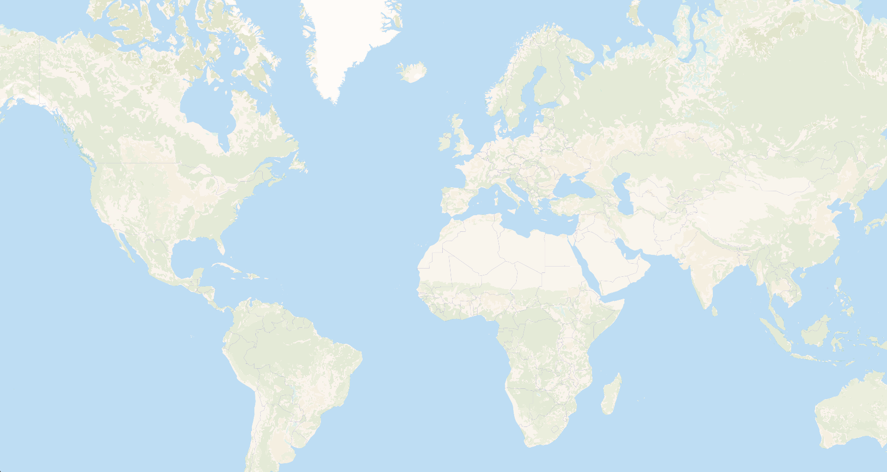
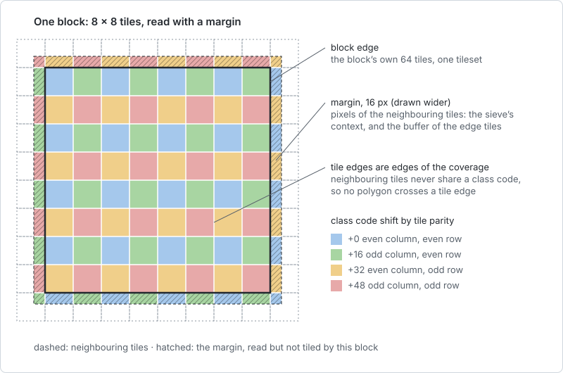

# VersaTiles Landcover Vectors

Global land cover for zoom levels 0–10, as vector tiles to draw under an OSM-based
[Shortbread](https://shortbread-tiles.org/) map. Built from [ESA WorldCover 2021](https://esa-worldcover.org/en/data-access),
with OpenStreetMap's land use burned in.

OpenStreetMap's land cover is hand-mapped, so it is patchy, and Shortbread shows most of it only from z11. This
tileset is a complete classification from satellite imagery, in one layer, `landcover`, with Shortbread's `kind`
values. A map draws it as a source of its own under OSM: OSM paints over it where it has data, and the land cover
shows wherever OSM has none, at every zoom. Where OSM maps land use — a town, a park, allotments, a forest — that
goes into the classification first, so the two agree where both exist (see [OSM land use](#osm-land-use)).

**Download** [`landcover-vectors.versatiles`](https://download.versatiles.org/landcover-vectors.versatiles)
(~4.5 GB) from [download.versatiles.org](https://download.versatiles.org/).



## Contents

- [What's in the tiles](#whats-in-the-tiles)
- [Using it with OSM](#using-it-with-osm)
- [Building](#building)
- [How it works](#how-it-works)
- [Development](#development)
- [License](#license)

## What's in the tiles

One layer, `landcover`, with one attribute, `kind`. Each ESA WorldCover class becomes the Shortbread `kind` a style
already knows how to colour; the third column is the Shortbread layer in which OSM has that kind, and whose fill a
style copies for it:

| ESA WorldCover class     | `kind`        | OSM's layer      | zooms |
| ------------------------ | ------------- | ---------------- | ----- |
| Tree cover               | `forest`      | `land`           | z0–10 |
| Cropland                 | `farmland`    | `land`           | z0–10 |
| Built-up                 | `residential` | `land`           | z0–10 |
| Bare / sparse vegetation | `bare_rock`   | `land`           | z0–10 |
| Moss & lichen            | `heath`       | `land`           | z0–10 |
| Shrubland                | `scrub`       | `land`           | z0–10 |
| Grassland                | `grassland`   | `land`           | z0–10 |
| Herbaceous wetland       | `marsh`       | `land`           | z0–10 |
| Mangroves                | `swamp`       | `land`           | z0–10 |
| Snow and ice             | `glacier`     | `water_polygons` | z0–10 |
| Permanent water bodies   | `water`       | `water_polygons` | z0–10 |
| No data                  | _(dropped)_   | —                | —     |

**The sea is a hole** for Shortbread's `ocean` layer to fill: every block masks out OSM's sea polygons, the ones
Shortbread's `ocean` is built from, before it classifies ESA's pixels (see [ocean mask](#ocean-mask)). So the land
cover ends at OSM's coastline, and ESA's own sea — which it classifies as permanent water inside its coastal 3°
tiles — never becomes `water`. Lakes are not part of OSM's sea and stay.

Some mappings are deliberately **lossy generalizations** — ESA can't resolve the OSM detail, and at these
zooms it doesn't matter visually:

- **Built-up → `residential`** — ESA's single "built-up" class can't distinguish residential / industrial /
  commercial; `residential` is the generic settlement fill.
- **Bare / sparse vegetation → `bare_rock`** — this class conflates rocky/gravelly barrens (Iceland, tundra,
  high mountains) with sandy deserts, which ESA can't tell apart; `bare_rock` renders neutrally for both,
  where `sand` would tint every barren yellow. Sandy deserts lose their sand tint as a result.
- **Moss & lichen → `heath`** — Shortbread has no moss/lichen value; `heath` is the closest low tundra
  vegetation fill.

`wetland` is split to keep fidelity: herbaceous wetland → `marsh`, mangroves → `swamp`.

The container declares `tile_schema: versatiles/landcover@1.0`, the schema of this layout.

## Using it with OSM

A style has two vector sources: OSM's Shortbread tiles, unchanged, and this container. It draws, bottom to top:

1. the background
2. the land cover's fills, in versatiles-style's `osm.slots.belowFills`
3. OSM's `ocean`
4. OSM's layers, as they are

Each land cover fill is a copy of the style's fill for the same kind in OSM's tiles, with its colour, reading the
`landcover` layer, without its `minzoom`, and with this opacity:

```json
["interpolate", ["linear"], ["zoom"], 12, 1, 14, 0.25]
```

The tiles end at z10, and MapLibre overzooms them above that. So the land cover is opaque up to z12, where its
outlines grow coarse, fades to 25 % by z14, and stays at 25 % above that: land that OSM does not map keeps a hint of
colour. OSM's own forests, lakes and towns draw on top wherever OSM has them, so nothing needs filtering. For
versatiles-style's colorful style, the copy of `land-forest` reads:

```json
{
	"id": "landcover-land-forest",
	"type": "fill",
	"source": "versatiles-landcover",
	"source-layer": "landcover",
	"filter": ["in", ["get", "kind"], ["literal", ["forest"]]],
	"paint": { "fill-color": "rgb(203,229,184)", "fill-opacity": ["interpolate", ["linear"], ["zoom"], 12, 1, 14, 0.25] }
}
```

versatiles-style draws it from v8 on: `osm({ features: { landcover: true } })` adds the source and these fills,
reading the land cover from `urls.landcover`, by default tiles.versatiles.org's `landcover-vectors`. `npm run dev`
shows that style over this repo's tiles.

**Why a source of its own.** OSM maps only part of the land. Measured on one inland z8 tile per region (OSM
container of October 2026), the share of land that OSM's `land` and `water_polygons` cover at z11:

| region                  | covered at z11 |     | region                 | covered at z11 |
| ----------------------- | -------------- | --- | ---------------------- | -------------- |
| Borneo, interior        | 99.5 %         |     | Russia, Siberia        | 20.8 %         |
| Netherlands, Gelderland | 89.2 %         |     | USA, Iowa              | 13.8 %         |
| Germany, Hesse          | 84.7 %         |     | Canada, Manitoba north | 9.4 %          |
| DR Congo, basin         | 83.1 %         |     | India, Ganges plain    | 3.1 %          |
| Brazil, Mato Grosso     | 40.4 %         |     | Niger, Sahel           | 2.7 %          |
| Spain, Castilla         | 35.2 %         |     | Australia, outback     | 0.1 %          |

Up to version 3 the land cover was merged into OSM's `land` and `water_polygons`, and OSM took over at z11: outside
Central Europe and the large rainforests, most of the coloured land turned into the style's background there. Under
OSM, it stays.

**At z10, the land cover's towns are OSM's.** OSM's urban kinds (`industrial`, `commercial`, `retail`, `railway`, …)
start at z10. The land cover has them burned in as `residential`: where ESA sees trees inside an OSM residential
area, the land cover is built-up there too, unless OSM itself maps a wood or a park. Where OSM maps nothing, ESA's
classification shows.

## Building

### Requirements

The quickest way is [pixi](https://pixi.sh) (`brew install pixi`, or `curl -fsSL https://pixi.sh/install.sh | sh`):

```sh
pixi install       # GDAL, tippecanoe, curl, osmium and Node.js from conda-forge, the versions pinned in pixi.lock
pixi run doctor    # checks every tool the pipeline runs, and says how to fix what is missing
```

`pixi run build` (or `download`, `preview`, `stats`, …) then runs the npm script in that environment;
CI tests against the same lockfile. versatiles comes with the npm dependencies
([`@versatiles/versatiles-rs`](https://www.npmjs.com/package/@versatiles/versatiles-rs), pinned in
`package-lock.json`) and runs inside the build, so the `versatiles` command is not needed.

Without pixi, install these yourself; `npm run doctor` checks them all, and every command checks its own before
it starts:

- `node` ≥ 22.18
- [`GDAL`](https://gdal.org/) ≥ 3.13 with `gdalbuildvrt`, `gdaladdo`, `gdalwarp`, `gdalinfo`, `gdal_translate`, `gdal_calc.py`, `gdal_rasterize`, `ogr2ogr`, `ogrinfo` and the `gdal raster` / `gdal vector` subcommands `sieve`, `polygonize` and `simplify-coverage` on `PATH`
- Python 3 with `numpy` (used by `gdal_calc.py` for the class index; both ship with the GDAL install)
- [`tippecanoe`](https://github.com/felt/tippecanoe) (e.g. `brew install tippecanoe`) — `tippecanoe-decode`, which ships with it, is used by `npm run inspect` and `npm run stats -- --attribute`
- `curl`, for the ocean mask and OSM's land use
- [`osmium`](https://osmcode.org/osmium-tool/) (e.g. `brew install osmium-tool`), which cuts OSM's land use out of the planet for `npm run download` and `npm run experiment`
- for `npm run preview`: a browser, and internet access for MapLibre GL from a CDN, the OSM container and versatiles-style's fonts and icons (the land cover tiles themselves are served locally)

### Run

```sh
npm run download   # once: the EPSG:3857 source raster from ESA's remote tiles, the ocean mask, OSM's land use
npm run build      # everything else → data/landcover-vectors.versatiles
```

> [!IMPORTANT]
> **Resources.** A full z0–10 build needs roughly **150 GB** of disk under `data/` (the ~19 GB EPSG:3857 source,
> the ~1.3 GB ocean polygons, the ~0.4 GB sea share, OSM's land use as ~16 GB cut and ~56 GB import, the ~19 GB
> burned classes, the per-block tilesets and, each about as large, the per-zoom tilesets and the joined tileset;
> another ~95 GB while the planet downloads) and on the order of **300 core-hours** of CPU. It's
> heavily parallelised, but plan for a long run on a many-core machine with ample free disk.

Everything reads and writes under `data/`; `LANDCOVER_DATA_DIR` moves it, and `LANDCOVER_SOURCE_DIR` lets
several data dirs share one source raster. All parameters live in `config.ts`.

The build processes one block per core, each with a single GDAL thread (more threads per block only cost CPU:
on a 42-block sample, 9 blocks with all cores each took 25 % longer than 14 blocks with one thread each, for
identical fragments). Every block holds its window and polygons in memory, so where memory runs short,
`LANDCOVER_CONCURRENCY` sets fewer blocks at once.

The build is **resumable**. Every block's tileset (`data/1_results`) is written atomically and skipped on a
re-run, so an interrupted build continues where it stopped. Once all blocks of a zoom are done, their tiles are
joined into `data/2_tiles/z{z}.mbtiles`, a tileset of the whole zoom to watch, serve or inspect while the build
goes on (`npm run preview -- --tiles data/2_tiles/z7.mbtiles`, `npm run stats -- --input data/2_tiles/z7.mbtiles`); a re-run skips every
zoom that has one. The cache is
stamped with a fingerprint of the parameters they were built with: after a change in `config.ts` the build
names what changed and refuses to mix old and new. `npm run clean` clears them (the download stays), or point
`LANDCOVER_DATA_DIR` at a fresh directory.

## How it works

Each step reads what an earlier one wrote; all files are under `data/`:

| command            | step                                                                     | reads                            | writes                                                   |
| ------------------ | ------------------------------------------------------------------------ | -------------------------------- | -------------------------------------------------------- |
| `npm run download` | [reproject ESA WorldCover](#source-raster)                               | ESA's 3° tiles on S3             | `0_download/worldcover-3857.tif`, with overviews         |
|                    | [rasterize the sea](#ocean-mask)                                         | OSM's water polygons             | `0_download/seashare-3857.tif`, with overviews           |
|                    | [cut the planet to its land use, import it](#osm-land-use)               | OSM's planet                     | `0_download/osm-landuse-<date>.osm.pbf`, `….vrt`         |
|                    | [burn it into the source](#osm-land-use)                                 | the source raster, the land use  | `0_download/worldcover-osm-3857.tif`, with overviews     |
| `npm run build`    | [process and tile each block](#per-block-processing), for each zoom 0–10 | the burned source, the sea share | `1_results/z{z}_{x}_{y}.mbtiles`, one per block          |
|                    | join each zoom                                                           | its blocks' tilesets             | `2_tiles/z{z}.mbtiles`                                   |
|                    | [pack](#pack)                                                            | `2_tiles/z{z}.mbtiles`           | `landcover.mbtiles`, then `landcover-vectors.versatiles` |

Before the blocks, `build` reads which 3° cells ESA has tiles for (the [coverage index](#coverage-index)) and
skips every block that touches none of them.

### Blocks

A naïve pipeline renders one global EPSG:3857 raster per zoom level. At the resolution we want that reaches
60000×60000 px and beyond, and a global coverage-simplify loads the whole thing into RAM and gets OOM-killed.
Instead each zoom is processed in **blocks** of `BLOCK`×`BLOCK` = 8×8 tiles (`TILE_PX` = 1024 raw px per tile),
so every raster/vector operation works on a ≤ ~8246² px window (z0–2 read finer, `TILE_PX_LOW`, but cover at most 4×4 tiles) — bounded memory, feasible at every zoom. Each
block is tiled on its own, and the blocks' tiles are joined into one tileset per zoom.

### Source raster

`npm run download` reads the [ESA WorldCover 2021 (v200)](https://registry.opendata.aws/esa-worldcover-vito/)
tiles **directly from AWS Open Data** (`s3://esa-worldcover`) over `/vsicurl`. The ~2651 remote GeoTIFFs are
mosaicked into one virtual raster (`gdalbuildvrt`), and a single `gdalwarp -r mode` (dominant class, the right
choice for categorical data) reprojects them into **one EPSG:3857 GeoTIFF** at the deepest zoom's resolution
(`FULL_PX` = `TILE_PX`·2^`MAXLEVEL` = 1 048 576 px per side, ≈ 38 m/px): `data/0_download/worldcover-3857.tif`.
`gdaladdo` then adds an overview pyramid down to z0.

The warp reads ESA's internal overviews rather than the full 10 m data, so it transfers a fraction of the
~124 GB dataset. The output is tiled, ZSTD-compressed (level 9), BigTIFF and **sparse** — all-ocean blocks
aren't stored. It is written atomically, so an interrupted run leaves no half-built source. A re-run keeps a
raster that is already there (unless it was built for another `TILE_PX`); delete it to rebuild.

### Ocean mask

ESA classifies the sea inside its coastal 3° tiles as permanent water, and its coastline is not OSM's. The
download therefore also fetches [OSM's water polygons](https://osmdata.openstreetmap.de/data/water-polygons.html)
(`water-polygons-split-3857`, ~930 MB, updated daily from OSM's coastline) — the file planetiler-shortbread
builds Shortbread's `ocean` layer from — and converts them to a FlatGeobuf with a spatial index,
`data/0_download/water-polygons-3857.fgb`.

It then rasterizes them once into a **sea-share pyramid**, `data/0_download/seashare-3857.tif` (`lib/ocean.ts`):
the source raster's own grid, each base pixel 100 (sea) or 0 (land) — the polygons simplified to half a pixel,
pixel centres inside count — and average overviews down to z0, so every level holds the true sea share of its
pixels. It is built in 16384² px tiles in parallel, mosaicked and stamped with the polygon file it came from;
an interrupted run resumes from the tiles already done. It takes ~13 minutes on 14 cores and ~385 MB.

Every block reads its window of the pyramid at its own zoom, the way it reads the classes from the source: a
block's grid lines up with one level, so a small VRT points at that level and the window's rectangle in it, and
the class index reads it as a second input. A pixel whose sea share is at least `SEA_SHARE_MIN` = 50 % becomes
no-data. The result:

- The land cover ends at OSM's coastline. At z10 the mask is the burn itself (pixel-identical on the
  coastal blocks checked); below, a pixel is sea when most
  of it is, which keeps the sea's area within ±0.2 % of an exact burn at that zoom and moves the coastline by
  single pixels (0.1–0.2 % of a coastal block's pixels). So it neither overlaps OSM's ocean nor leaves a gap.
- ESA's coastal sea is gone at every zoom, also from `water` at z0–3 and from the container on its own.
- Lakes stay: they are not in OSM's sea. Neither is ESA sea inside OSM's land (a harbour, a recently
  reclaimed coast), which stays as `water`; from z4, OSM's own water draws over it wherever OSM maps some.
- ESA classes seaward of OSM's coastline are dropped, e.g. salt marsh on the outer tidal flats.

Per block it costs next to nothing: the class index reads the share window alongside, about 0.03 s. Burning
the polygons into every block instead cost up to a minute on a complex coast below z10 (Scandinavia, z6–9) and
~100 s for the world-sized blocks of z0–3. The mask and its threshold are part of the cache fingerprint. The
polygons' date is not, so a newer coastline doesn't invalidate a cache: delete the polygon file and re-run
`npm run download` to refresh it; the sea share follows.

### OSM land use

ESA sees what is on the ground: trees in a leafy suburb, grass in a park. OSM maps what the land is used for: the
suburb is residential, the park a park. Shortbread draws OSM's from z11 on, so without it the map changed at the
handover wherever the two disagree — in Berlin, z10 showed what z11 shows on 58–60 % of what OSM maps, in
Atlanta's tree-canopy suburbs on 30 %. So the download burns OSM's land use into ESA's classes, and the blocks
read those (`lib/landburn.ts`); with it, 86–98 % in nine of the ten test regions of `npm run experiment`
(Tokyo, which OSM maps sparsely, 73 %), and z10 is no longer blank where z11 has land use: 0–0.8 % of it, against up to 30 % (Tokyo) before. The cost: OSM's forest
shows as forest at z10 a little less often (Berlin 91–94 % against 98 %, Atlanta 77 % against 95 %), as small
woods inside what is now a solid town are sieved away.

- **Cut.** It fetches the newest weekly planet (`planet-<YYMMDD>.osm.pbf`, ~95 GB, checked against its MD5; a
  broken download resumes) and cuts it with `osmium tags-filter` to the areas with a tag value Shortbread's
  `land` layer accepts: `data/0_download/osm-landuse-<date>.osm.pbf`, ~16 GB. The planet is removed after. On
  14 cores: the download at ~15 MB/s, the check 2 minutes, the cut 9.
- **Import.** `osmium export` assembles the areas, ways and multipolygons; each gets its kind by
  planetiler-shortbread's rules (`lib/osmland.ts`, which follows its `Land.java`, precedence and all) on its way to
  `ogr2ogr`, one pipe from the PBF to the FlatGeobuf. osmium keeps every node's location in memory, 16 bytes a
  node, and the cut has 2.2 billion: ~35 GB, more than the machine has, and with the index as a file on disk the
  export would take ~17 hours. So the cut is split in halves of its box, again and again, until each part's nodes
  fit in ~3 GB (`osmium extract`, which keeps an area across a cut whole in both parts, multipolygon and boundary
  relations alike: national parks often carry a land use). Each part becomes a FlatGeobuf with a spatial index, and
  `osm-landuse-<date>.vrt` reads them as one layer: for the 2026-10-19 planet, 81.5 million polygons in 17 parts,
  56 GB, in 70 minutes on 14 cores, at ~4.5 GB of memory. This is the land use itself, not the OSM container's
  tiles: those drop what is under a pixel at z11, lack what Shortbread starts later (cemeteries, z13), and would
  have to be decoded tile by tile.
- **Burn.** Each burn in `config.ts` `OSM_BURNS` writes one ESA class over the polygons of its kinds — urban as
  built-up, fields as cropland, parks and allotments as grassland, woods as tree cover, … — in versatiles-style's
  draw order, so where two overlap, the one drawn on top at z11 wins. Not burned: cemeteries and grave yards
  (drawn only from z13), brownfield and greenfield (not drawn at all), water (OSM's from z4 anyway). The burn
  happens on the source's own grid, pixel centres inside, in 16384² px tiles in parallel like the sea share;
  tiles without land use are left to the source. The burned tiles are laid over the source and written as
  `data/0_download/worldcover-osm-3857.tif`, with mode overviews like the source's: so a burned pixel is
  resampled, sieved and simplified exactly like ESA's own. On 14 cores, the tiles take ~40 minutes, and the
  mosaic and its overviews about as long as the source's own. Built from the ten test regions' ESA, the world's
  classes are the experiment's region sources pixel for pixel, but for 2 of 160 million: at a region's corner,
  under a polygon without a node in the region, which the region's cut-out leaves out.

The classes are stamped with the source and the import they came from and the burn table, so a re-run rebuilds
them when one changes. The burn table is part of the build's cache fingerprint; the land use's date is not, as
with the coastline: delete the `osm-landuse-*` files and re-run `npm run download` to refresh it. OSM's land use
is unevenly mapped: where it is dense (much of Europe and North America) the burn shows it; where
OSM maps little, ESA's classification is all there is, as before.

### Coverage index

ESA only ships 3° tiles where land exists. `lib/coverage.ts` builds the set of occupied 3° cells from the
source tile list (`_source-tiles.txt`, saved by the download), and a block that intersects no occupied cell is
skipped. At high zoom most blocks are ocean, so this removes the bulk of the work. The test is conservative:
it never skips a block that overlaps land.

### Per-block processing

`lib/block.ts` turns one block at one zoom into its `landcover` tiles. It reads the block's window
plus a margin from the source and the matching window of the sea share (see [ocean mask](#ocean-mask)), both
straight from the pyramid level for its zoom (so a low-zoom block reads ≈100× less): a block's grid lines up with
a level, so a small VRT points at the window's rectangle in it, with no warp and no resampling, then:

| step         | tool                            | what the block is afterwards                                                 |
| ------------ | ------------------------------- | ---------------------------------------------------------------------------- |
| read         | VRTs                            | the window plus margin, and its sea share — rasters                          |
| fast paths   | `gdalinfo -hist`                | all sea: an empty tileset, done; one kind and no sea: one rectangle, go to 7 |
| 1 classify   | `gdal_calc.py`                  | a raster of class indices, with sea and inactive classes as no-data          |
| 2 sieve      | `gdal raster sieve`, two passes | the same raster without patches below the sieve size                         |
| 3 cut        | VRT                             | the same raster, its codes shifted per tile so no patch crosses a tile edge  |
| 4 polygonize | `gdal raster polygonize`        | a gap-free polygon coverage, no-data included — vectors from here on         |
| 5 simplify   | `gdal vector simplify-coverage` | the same coverage, its shared edges simplified to ≈ 1 px                     |
| 6 tag        | `ogr2ogr`                       | `landcover` with its `kind`, no-data dropped                                 |
| 7 tile       | `tippecanoe`                    | `1_results/z{z}_{x}_{y}.mbtiles`, the block's own tiles                      |

1. **Classify** — one `gdal_calc.py` call maps each pixel's ESA code to its class index. ESA's no-data,
   every inactive class and OSM's sea fold into the no-data class. Each pixel keeps its own class: there is no smoothing
   before the sieve, because a blur cost accuracy (see [doc/TUNING.md](doc/TUNING.md)).
2. **Sieve** — `gdal raster sieve` merges patches smaller than `SIEVE_RENDERED` = 5 rendered px² at z9–10, and less below
   (`SIEVE_RAMP`, from 1 px² at z0 to 3 px² at z8). At 5 px²
   (`SIEVE_THRESHOLD` = round(5·4²) = 80 px) they merge into their largest neighbour, in two passes (`SIEVE_STAGES`):
   first at a quarter of that, 20 px, then at 80 px. A single pass leaves much of a fragmented mosaic untouched,
   because most neighbours of a small patch are small too (see [doc/TUNING.md](doc/TUNING.md)). A round majority
   filter of `SMOOTH_RENDERED` = 0.5 rendered px radius then rounds the shapes, and a last sieve at 80 px takes what it
   cut off.
3. **Cut at the tile edges** — a VRT over the sieved window shifts each tile's class codes by 0, 16, 32 or 48,
   by the parity of its column and row, so neighbouring tiles never share a code and no polygon crosses a tile
   edge. tippecanoe can then leave every polygon as it is in its own tile: cutting a huge polygon (thousands of
   holes) down to a tile, it can lose the outer ring and keep only the holes.
4. **Polygonize** — `gdal raster polygonize`, giving a gap-free coverage of the window, **no-data included**. Its
   borders are then noded and their corners cut (`OUTLINE`, `lib/outline.ts`), identically on both sides of each border.
5. **Simplify** — `gdal vector simplify-coverage --preserve-boundary`, tolerance
   `(2·MERC)/(256·DETAIL_PX·2^z)` ≈ 1 px at a 256·`DETAIL_PX` px tile (`DETAIL_PX` = 1.5 today).
   ⚠️ It simplifies only edges _shared_ between polygons, which is why no-data must still be there: without it,
   every coastline would be an outer edge and keep its pixel staircase.
6. **Tag** — drop no-data and tag each polygon with its `kind` (margin included). The polygons stay in EPSG:3857, which tippecanoe reads directly: reprojected to
   EPSG:4326, straight edges bend, and a hole touching its shell at a point can end up crossing it.
7. **Tile** — one `tippecanoe -Z z -z z` over the block → `data/1_results/z{z}_{x}_{y}.mbtiles`, keeping only
   the block's own tiles (tippecanoe also writes the ones the margin reaches into). `--coalesce-smallest-as-needed`
   keeps the coverage complete: when a low-zoom tile would exceed the size limit, the smallest polygons merge into
   their neighbours instead of being dropped. `--coalesce --reorder` writes each kind of a tile as one feature.



The **margin** (`MARGIN_PX` = ceil(3·√`SIEVE_THRESHOLD`) = 27 px) lets the sieve at the inner edge see the
same neighbourhood as a global pass would, so a class never changes across a block
seam. Because tile edges, the block's included, are edges of the coverage, simplify-coverage keeps them straight
and keeps the points where a border crosses one, which a neighbouring block shares, so borders meet at the seam.
The margin's pixels belong to the neighbouring tiles, and their polygons are the tile buffer (`TILE_BUFFER` =
⌊27 px / 4⌋ = 6 rendered px) of the tiles along the block's edge, so no tile needs a neighbour's polygons and no
hairline shows at a seam.

Each kind is active up to its cutoff (`maxZoom` in `config.ts`, z10 for every kind today). Above it, a class
folds into no-data.

**Fast paths.** Histograms of the window and its sea share (`gdalinfo -hist`) say which ESA values occur and
how much of the window is sea. A block that is all sea is empty. Only the kinds present get a class index, which
is exact, not an approximation. If the whole window is a single kind and none of it is sea, the block is emitted
directly as one rectangle of that kind. ⚠️ The sea is not burned into the window, so ESA's histogram still counts
what lies under it — ESA's own sea is class 80 inside its coastal tiles — and an open-sea block would look like
one class of water without the sea count. GDAL also leaves no-data out of the histogram, so "a single value"
requires the histogram to count every pixel of the window as well.

### Pack

`lib/assemble.ts` copies the per-zoom tiles into `data/landcover.mbtiles` (zooms, like blocks, never share a
tile, so this is a plain copy, nothing is decoded), and versatiles (`@versatiles/versatiles-rs`, in the build's own
process) packs it with brotli into `data/landcover-vectors.versatiles`, the name it is published under. Its whole metadata is one TileJSON,
`data/tmp/container-meta.json`, which `meta_update tilejson_file=…` puts in place of the mbtiles' own:
`tile_schema: versatiles/landcover@1.0` (see [what's in the tiles](#whats-in-the-tiles)); name, description, attribution,
revision (`version`), center and the layer descriptions from `meta` in `config.ts`; bounds, zooms and layers of
the joined tileset; and, like the `planetiler:*` keys of `osm.versatiles`, the build it came from:
`landcover:fingerprint` (the config), `landcover:githash` (the commit, `-dirty` with uncommitted changes) and
`landcover:buildtime`. Before the container takes its final name, pack reads its metadata back and stops if
any of it differs from what was written, if its tile type is not vector tiles, or if its one layer lacks a
description or doesn't span every zoom. The build ends with a per-zoom tally of how its blocks were processed, from
`data/blocks.log`.

## Development

| command              | what it does                                                                             |
| -------------------- | ---------------------------------------------------------------------------------------- |
| `npm run dev`        | look at OSM, the land cover and both stacked in versatiles-style, switching between them |
| `npm run preview`    | build one area, serve it next to real OSM data and open a viewer                         |
| `npm run stats`      | tile size distribution, worst tiles, and a baseline to diff builds against               |
| `npm run timings`    | where a download or build spent its time, per step and per command                       |
| `npm run sweep`      | build an area once per parameter value and compare size and quality                      |
| `npm run inspect`    | compare one tile pixel by pixel with what it should show, as numbers and a PNG           |
| `npm run experiment` | build variants of the pipeline over test regions and measure the handover                |
| `npm run style`      | write a QGIS vector-tiles style (`landcover.qml`) in versatiles-style's colours          |
| `npm run clean`      | delete the build caches (keeps the download)                                             |
| `npm run check`      | typecheck, formatting and tests                                                          |

### Timings

Download, build and preview log how long every step and every external command took, to `data/timings.jsonl`
(a preview to its own directory). Each command knows its step and, inside the build, its block, e.g.
`build/z10/blocks/block/sieve` for `z10_33_39`. `npm run timings` sums up the last run: per step, per command
(with the average number of commands running at the same time, which wall times under load have to be read
against) and the slowest single commands with their block or sea-share tile. `--zooms` keeps the zooms apart,
`--runs` lists earlier runs and `--run <id>` picks one.

### Dev

```sh
npm run dev                                # the published landcover container
npm run dev -- --local                     # the local build, data/landcover-vectors.versatiles
npm run dev -- --landcover <path|url>      # any other, e.g. an experiment's build
npm run dev -- --ip 0.0.0.0                # on a server: reachable from other machines (default: this one only)
```

Serves OSM's Shortbread container and the landcover container from one in-process server
(`@versatiles/versatiles-rs`), without downloading anything. OSM always comes from `download.versatiles.org`. The map
(`dev/map/`) switches between **osm**, **landcover** and **osm+landcover** (keys 1, 2, 3) at the same position, each
drawn with versatiles-style's colorful style: osm as OSM looks today, the land cover alone, and the land cover under
OSM (see [using it with OSM](#using-it-with-osm)). The header shows the zoom and whether the land cover is overzoomed
or fading there.

### Experiments

```sh
npm run experiment                      # build and measure every variant (lib/variants.ts)
npm run experiment -- burn baseline     # just these
npm run experiment -- --report          # the tables of everything measured so far
npm run experiment -- --render a b      # the regions as these variants draw them, side by side, in results/render
npm run experiment -- --planet 8-9 a    # build these zooms of a variant over the whole planet, and compare its bytes
```

Compares variants of the pipeline — OSM land use burned into ESA's classes, other outlines — on ten test
regions (`lib/regions.ts`), each picked for one way the land cover and OSM disagree. Each region gets a small
source of its own on the build's pixel grid (`lib/regionsource.ts`): ESA from the bucket, OSM's sea from the
download's water polygons (fetched if missing), and OSM's land use imported from the planet. That needs one
download first, `npm run download -- --landuse`: the newest planet (~95 GB, an hour or two), cut by
`osmium tags-filter` to the areas Shortbread's `land` layer is built from (~16 GB,
`data/0_download/osm-landuse-<date>.osm.pbf`); the planet itself is removed after. The experiment cuts its
regions out of that and imports each like the download imports the world (`lib/osmland.ts`), cemeteries and polygons under a pixel at z11 included, which the tiles lack. A variant
builds z8–10 with the build's own pipeline, and `lib/measure.ts` paints the map the way versatiles-style draws it — the land cover
under OSM at z8–10, OSM alone at z11–13 — and compares the zooms pixel by pixel: how often z10 shows what OSM shows
at z11, holes, towns, forest, tile size — per region, and per Shortbread `land` and `water_polygons` kind, located
with OSM's z14 tiles. The tables go to
`data/experiment/results/report.md`. `baseline` is the pipeline as configured, with OSM's land use burned in;
`esa` is the pipeline before the burn, which matched the published version-3 container to within half a point at
z10 (1–2 points at z8), the noise to read differences against. `published` reads the `landcover` layer, so it
measures nothing until a container with that layer is published.

The report's summary gives each variant's size in gzipped bytes, weighted by each zoom's share of the planet; the
per-region tile tables are uncompressed, as `getTile` gunzips, and overstate what a change saves. The regions read about 3 points
low against a planet build, so a variant meant to hold the size is checked with `--planet`. Measurements of the outline
variants: [doc/TUNING.md](doc/TUNING.md#outlines).

### Preview

```sh
npm run preview -- --area hudson-bay --zoom 4-10   # build that area, serve it, open the viewer
npm run preview -- --bbox 4,58,12,64 --watch       # rebuild and reload when config.ts changes
npm run preview -- --tiles data/landcover.mbtiles  # just look at an existing tileset
```

A parameter change is worth a few minutes on one area, not a full build. The preview runs the area's blocks
through **the same** `lib/pipeline.ts` as the build and serves the result with versatiles' tile server, in the preview's own process. Each parameter
set builds into its own `data/preview/<config fingerprint>/`, so switching back and forth reuses the caches.

The viewer (`dev/viewer/`, MapLibre GL) mounts the **real OSM Shortbread container** from
`download.versatiles.org` alongside, with OSM's fills of the same kinds on top, so the land cover can be checked
against real data. OSM's `ocean` sits under the land cover, so no-data holes show up as ocean. The viewer also has a
block-grid overlay, a legend with per-kind toggles, click-to-inspect, and the config fingerprint in the header,
so a screenshot documents itself. The position is in the URL hash (`#z/lat/lon`), which is what
`npm run stats -- --worst` prints.

It has two styles. **debug** colours each land cover kind distinctly, so you can tell them apart and toggle
them. **versatiles-style** is the real map: versatiles-style's colorful style (`@versatiles/style`) with the
land cover under OSM (see [using it with OSM](#using-it-with-osm)). It shows versatiles-style's draw order, OSM's
other kinds, roads and labels — what users will see. With `--no-osm`, only the debug style is offered. `?style=versatiles` in the URL opens it directly.

### Tuning

| stage  | knob                                                         | what it changes                                                                                      | override                   |
| ------ | ------------------------------------------------------------ | ---------------------------------------------------------------------------------------------------- | -------------------------- |
| raster | `SIEVE_RENDERED` (5 rendered px²), `SIEVE_RAMP` below z9     | the smallest patch kept, sieved in two passes; the main lever on feature count; 0 turns it off       | `LANDCOVER_SIEVE_RENDERED` |
| vector | `DETAIL_PX` (1.5)                                            | the simplify tolerance — how precisely outlines follow the result                                    | `LANDCOVER_DETAIL_PX`      |
| raster | `TILE_PX` (1024 → 38 m/px at z10, against ESA's native 10 m) | the resolution the source is classified at; 4× source raster and CPU per doubling, and a re-download | — (edit, then re-download) |
| raster | `TILE_PX_LOW` (4096 at z0–1, 2048 at z2)                     | a finer level of the pyramid at the lowest zooms, for a few KB; no re-download                       | — (edit)                   |

The overrides are for sweeps; each value builds into its own cache, because all knobs are part of the config
fingerprint. The largest tiles sit in Hudson Bay's wetland mosaic; at the 5 px² sieve its worst z8 tile is 69 KB,
far below tippecanoe's 500 000-byte limit (122 KB in the z0–9 build at the 1.77 px² sieve before). How
to measure a change, and what the measurements so far say, is in [doc/TUNING.md](doc/TUNING.md).

## License

- [ESA Worldcover](https://esa-worldcover.org/en/data-access) is licensed [CC BY 4.0](http://creativecommons.org/licenses/by/4.0/)
- The ocean mask is [OSM's water polygons](https://osmdata.openstreetmap.de/data/water-polygons.html), © OpenStreetMap contributors, [ODbL](https://opendatacommons.org/licenses/odbl/)
- From version 4 on, the tileset holds OSM's land use, burned into ESA's classes, so it is licensed under the [ODbL](https://opendatacommons.org/licenses/odbl/), © OpenStreetMap contributors, and contains ESA WorldCover data under [CC BY 4.0](http://creativecommons.org/licenses/by/4.0/). Up to version 3 it was derived from ESA WorldCover alone and licensed CC BY 4.0.
- The code in this repository is in the [Public Domain](http://unlicense.org/UNLICENSE)
