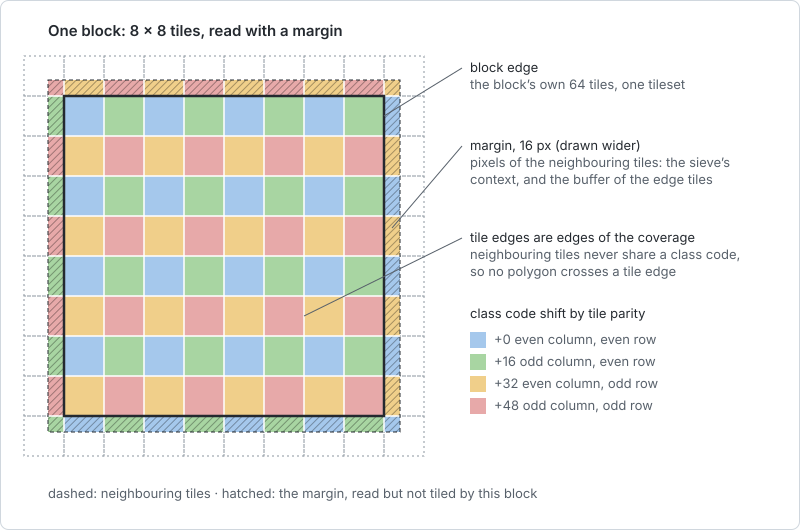

# VersaTiles Landcover Vectors

Global land cover for zoom levels 0–10, as vector tiles that merge into an OSM-based
[Shortbread](https://shortbread-tiles.org/) tileset. Built from [ESA WorldCover 2021](https://esa-worldcover.org/en/data-access).

OpenStreetMap's land cover is hand-mapped, so it is patchy, and Shortbread shows most of it only from z11. This
tileset fills z0–10 with a complete classification from satellite imagery, written into Shortbread's own `land`
and `water_polygons` layers and `kind` values, so a stock Shortbread style draws it without changes. From z11
on, OSM takes over.

**Download** from [download.versatiles.org](https://download.versatiles.org/):

- [`landcover-vectors.versatiles`](https://download.versatiles.org/landcover-vectors.versatiles) (~4.7 GB) — this
  tileset, to [merge with OSM](#merging-with-osm) yourself
- [`osm-landcover.versatiles`](https://download.versatiles.org/osm-landcover.versatiles) (~69 GB) — OSM
  Shortbread with it already merged in


## Contents

- [What's in the tiles](#whats-in-the-tiles)
- [Merging with OSM](#merging-with-osm)
- [Building](#building)
- [How it works](#how-it-works)
- [Development](#development)
- [License](#license)

## What's in the tiles

Each ESA WorldCover class becomes an existing Shortbread `kind`, so the output validates and styles as plain
Shortbread — no schema extension, no new style rules. The last column is what a merge with OSM uses of it; above
that zoom the kind comes from OSM (see [the handover](#the-handover)):

| ESA WorldCover class     | → layer          | `kind`        | this container fills | used in a merge |
| ------------------------ | ---------------- | ------------- | -------------------- | --------------- |
| Tree cover               | `land`           | `forest`      | z0–10                | z0–10           |
| Cropland                 | `land`           | `farmland`    | z0–10                | z0–10           |
| Built-up                 | `land`           | `residential` | z0–10                | z0–9            |
| Bare / sparse vegetation | `land`           | `bare_rock`   | z0–10                | z0–10           |
| Moss & lichen            | `land`           | `heath`       | z0–10                | z0–10           |
| Shrubland                | `land`           | `scrub`       | z0–10                | z0–10           |
| Grassland                | `land`           | `grassland`   | z0–10                | z0–10           |
| Herbaceous wetland       | `land`           | `marsh`       | z0–10                | z0–10           |
| Mangroves                | `land`           | `swamp`       | z0–10                | z0–10           |
| Snow and ice             | `water_polygons` | `glacier`     | z0–10                | z0–10           |
| Permanent water bodies   | `water_polygons` | `water`       | z0–10                | z0–3            |
| No data                  | —                | _(dropped)_   | —                    | —               |

Only `kind` is stored. **The sea is a hole** for Shortbread's `ocean` layer to fill: every block masks out
OSM's sea polygons, the ones Shortbread's `ocean` is built from, before it classifies ESA's pixels (see
[ocean mask](#ocean-mask)). So the land cover ends at OSM's coastline, and ESA's own sea — which it classifies as
permanent water inside its coastal 3° tiles — never becomes `water`. Lakes are not part of OSM's sea and stay.

Some mappings are deliberately **lossy generalizations** — ESA can't resolve the OSM detail, and at these
zooms it doesn't matter visually:

- **Built-up → `residential`** — ESA's single "built-up" class can't distinguish residential / industrial /
  commercial; `residential` is the generic settlement fill.
- **Bare / sparse vegetation → `bare_rock`** — this class conflates rocky/gravelly barrens (Iceland, tundra,
  high mountains) with sandy deserts, which ESA can't tell apart; `bare_rock` renders neutrally for both,
  where `sand` would tint every barren yellow. Sandy deserts lose their sand tint as a result.
- **Moss & lichen → `heath`** — Shortbread has no moss/lichen value; `heath` is the closest low tundra
  vegetation fill.

`wetland` is split to keep fidelity: herbaceous wetland → `marsh`, mangroves → `swamp`.

## Merging with OSM

### The handover

For most kinds there is **one handover, at z10 → z11**: up to z10 the land cover supplies them, from z11 OSM
does. Two kinds go to OSM earlier (see below); the mapping table above lists the zooms per kind.

OSM has its own copies of some kinds earlier — `forest` from z7, `farmland` from z10, `glacier` from z4 — but they are sparse where the satellite data is complete: in central Spitsbergen, OSM maps
9 % of a tile as glacier where ESA sees 96 % ice. So a merge **drops OSM's features of these kinds up to z10**.
Each zoom then has exactly one source per kind. OSM's other kinds (`river`, `reservoir`, `park`, …) are kept at
every zoom.

**`water` and `residential` are the exceptions.** Where OSM has them, they are more precise than ESA's, so the
merge keeps **OSM's** copy and drops the land cover's instead:

- **`water` from z4**, where Shortbread starts it. OSM's lakes are precise where ESA's are a classified raster.
  The land cover's `water` is only used at z0–3, where Shortbread has no lakes at all.
- **`residential` from z10**, where Shortbread starts every urban kind. OSM separates residential, industrial,
  commercial, retail and railway land; ESA's single built-up class would cover them all and, drawn on top,
  hide OSM's urban detail. The land cover's `residential` is used up to z9.

This container still carries both kinds to z10, so it also works on its own.

**Expect the land cover to thin out at z11**, in most of the world by far. At z10 every land pixel ESA
classifies is filled; from z11 only what OSM maps is. Measured on one inland z8 tile per region (OSM container of
October 2026), the share of land that OSM's `land` and `water_polygons` still cover at z11:

| region                  | covered at z11 |     | region                 | covered at z11 |
| ----------------------- | -------------- | --- | ---------------------- | -------------- |
| Borneo, interior        | 99.5 %         |     | Russia, Siberia        | 20.8 %         |
| Netherlands, Gelderland | 89.2 %         |     | USA, Iowa              | 13.8 %         |
| Germany, Hesse          | 84.7 %         |     | Canada, Manitoba north | 9.4 %          |
| DR Congo, basin         | 83.1 %         |     | India, Ganges plain    | 3.1 %          |
| Brazil, Mato Grosso     | 40.4 %         |     | Niger, Sahel           | 2.7 %          |
| Spain, Castilla         | 35.2 %         |     | Australia, outback     | 0.1 %          |

So where OSM's land use is mapped wall to wall (Central Europe, the large rainforests) the handover is barely
visible; elsewhere most of the coloured land turns into the style's background — farmland included, which
OSM rarely maps as land use outside Europe. That is the cost of handing over to hand-mapped data: carrying the
land cover beyond z10 would need a raster at twice the resolution per zoom (~4× disk and CPU) and, inside
Shortbread's `land` layer, would cover OSM's own kinds wherever both exist.

**At z10, both sources fill `land`.** OSM's urban kinds (`industrial`, `commercial`, `retail`, `railway`, …) start
at z10 and are kept, while the land cover still supplies its natural kinds. Where ESA sees trees or grass inside
an OSM residential or industrial area, the two overlap, and the style's layer order decides what shows: in
versatiles-style, `forest`, `grassland`, `scrub`, `bare_rock`, `marsh` and `farmland` are drawn above the urban
kinds, so ESA's green covers parts of towns at z10 that turn plain residential at z11.

### Merge with the VersaTiles CLI

> [!WARNING]
> **Don't merge without the filters.** This container fills every kind wall to wall up to z10, and OSM has its
> own copies of many of them. A plain `from_merged_vector [ osm, landcover ]` keeps both, so up to z10 the
> same `land` and `water_polygons` kinds come from two sources at once: OSM's sparse forest and glaciers on top
> of ESA's, ESA's classified lakes on top of OSM's precise ones from z4, ESA's built-up area covering OSM's urban
> detail at z10.

Filter both sources on the way into `from_merged_vector`. The filter's CEL strings use single quotes, which a
shell argument in single quotes cannot hold, so write the pipeline to a file:

```sh
cat > merge.vpl <<'EOF'
from_merged_vector [
  from_container filename="osm.versatiles"
    | vector_filter_features layer=["land"] expr="!(zoom <= 10 && kind in ['forest', 'farmland', 'bare_rock', 'heath', 'scrub', 'grassland', 'marsh', 'swamp'])"
    | vector_filter_features layer=["water_polygons"] expr="!(zoom <= 10 && kind in ['glacier'])",
  from_container filename="landcover-vectors.versatiles"
    | vector_filter_features layer=["land"] expr="!(zoom >= 10 && kind in ['residential'])"
    | vector_filter_features layer=["water_polygons"] expr="!(zoom >= 4 && kind in ['water'])"
]
EOF
versatiles convert -c brotli merge.vpl combined.versatiles
```

> [!WARNING]
> **Needs versatiles ≥ 4.15.0.** `vector_filter_features` gained the tile's `zoom` in 4.15.0. Older versions do
> not report an error: 4.14.0 silently drops every feature of the filtered layers, at every zoom, so the merged
> tileset ends up without `land` and `water_polygons`.

For a local build, `npm run merge` does the same: it downloads the latest
[OSM Shortbread container](https://download.versatiles.org/osm.versatiles) to `data/osm.versatiles` (~66 GB,
once and resumable), merges it with `data/landcover-vectors.versatiles` into `data/combined.versatiles`, and refuses to
run with versatiles below 4.15.0. Its filters are generated from `channels` in `config.ts` (`lib/handover.ts`),
so they follow any change of a cutoff.

`npm run verify-merge` checks a merge on real tiles, without downloading either container: it opens both
published containers raw, each filtered, and merged, reads the tile under 13 sample points at z0–14 from each,
and counts features per layer and `kind`. It fails when a kind still comes from both sources at a zoom, when a
filter drops features of the kind its source should supply, or when the merged tile is not exactly the two
filtered ones; it prints which source each kind comes from per zoom. `--landcover data/landcover-vectors.versatiles`
checks a local build before upload, `--unfiltered` the unfiltered merge, which has to fail.

## Building

### Requirements

The quickest way is [pixi](https://pixi.sh) (`brew install pixi`, or `curl -fsSL https://pixi.sh/install.sh | sh`):

```sh
pixi install       # GDAL, tippecanoe, curl and Node.js from conda-forge, the versions pinned in pixi.lock
pixi run doctor    # checks every tool the pipeline runs, and says how to fix what is missing
```

`pixi run build` (or `download`, `merge`, `preview`, `stats`, …) then runs the npm script in that environment;
CI tests against the same lockfile. Only versatiles is not on conda-forge yet:
`brew install versatiles-org/versatiles/versatiles`, or see its
[install instructions](https://github.com/versatiles-org/versatiles-rs/blob/main/versatiles/README.md#install).

Without pixi, install these yourself; `npm run doctor` checks them all, and every command checks its own before
it starts:

- `node` ≥ 22.18
- [`GDAL`](https://gdal.org/) ≥ 3.13 with `gdalbuildvrt`, `gdaladdo`, `gdalwarp`, `gdalinfo`, `gdal_translate`, `gdal_calc.py`, `gdal_rasterize`, `ogr2ogr`, `ogrinfo` and the `gdal raster` / `gdal vector` subcommands `sieve`, `polygonize` and `simplify-coverage` on `PATH`
- Python 3 with `numpy` (used by `gdal_calc.py` for the class index; both ship with the GDAL install)
- [`tippecanoe`](https://github.com/felt/tippecanoe) (e.g. `brew install tippecanoe`) — `tippecanoe-decode`, which ships with it, is used by `npm run inspect` and `npm run stats -- --attribute`
- [`versatiles`](https://github.com/versatiles-org/versatiles-rs/blob/main/versatiles/README.md#install) ≥ 5.0.0, the first to know the `shortbread@1.1` schema the build and the merge write
- `curl`, for the ocean mask and the OSM base
- for `npm run preview`: a browser, and internet access for MapLibre GL from a CDN, the OSM container and versatiles-style's fonts and icons (the land cover tiles themselves are served locally)

### Run

```sh
npm run download   # once: build the EPSG:3857 source raster from ESA's remote tiles, fetch and rasterize the ocean mask
npm run build      # everything else → data/landcover-vectors.versatiles
npm run merge      # optional: merge with OSM → data/combined.versatiles
```

> [!IMPORTANT]
> **Resources.** A full z0–10 build needs roughly **60 GB** of disk under `data/` (the ~19 GB EPSG:3857 source,
> the ~1.3 GB ocean polygons, the ~0.4 GB sea share, the per-block tilesets and, each about as large, the per-zoom
> tilesets and the joined tileset) and on the order of **300 core-hours** of CPU. It's
> heavily parallelised, but plan for a long run on a many-core machine with ample free disk.

Everything reads and writes under `data/`; `LANDCOVER_DATA_DIR` moves it, and `LANDCOVER_SOURCE_DIR` lets
several data dirs share one source raster. All parameters live in `config.ts`.

The build processes one block per core, each with a single GDAL thread (more threads per block only cost CPU:
on a 42-block sample, 9 blocks with all cores each took 25 % longer than 14 blocks with one thread each, for
identical fragments). Every block holds its window and polygons in memory, so where memory runs short,
`LANDCOVER_CONCURRENCY` sets fewer blocks at once.

The build is **resumable**. Every block's tileset (`data/1_results`) is written atomically and skipped on a
re-run, so an interrupted build continues where it stopped. Once all blocks of a zoom are done, their tiles are
joined into `data/2_tiles/z{z}.mbtiles`, a tileset of the whole zoom to watch, serve or inspect while the build
goes on (`npm run preview -- --tiles data/2_tiles/z7.mbtiles`, `npm run stats -- --input data/2_tiles/z7.mbtiles`); a re-run skips every
zoom that has one. The cache is
stamped with a fingerprint of the parameters they were built with: after a change in `config.ts` the build
names what changed and refuses to mix old and new. `npm run clean` clears them (the download stays), or point
`LANDCOVER_DATA_DIR` at a fresh directory.

## How it works

Each step reads what an earlier one wrote; all files are under `data/`:

| command                    | step                                                                     | reads                                            | writes                                                   |
| -------------------------- | ------------------------------------------------------------------------ | ------------------------------------------------ | -------------------------------------------------------- |
| `npm run download`         | [reproject ESA WorldCover](#source-raster)                               | ESA's 3° tiles on S3                             | `0_download/worldcover-3857.tif`, with overviews         |
|                            | [rasterize the sea](#ocean-mask)                                         | OSM's water polygons                             | `0_download/seashare-3857.tif`, with overviews           |
| `npm run build`            | [process and tile each block](#per-block-processing), for each zoom 0–10 | both rasters                                     | `1_results/z{z}_{x}_{y}.mbtiles`, one per block          |
|                            | join each zoom                                                           | its blocks' tilesets                             | `2_tiles/z{z}.mbtiles`                                   |
|                            | [pack](#pack)                                                            | `2_tiles/z{z}.mbtiles`                           | `landcover.mbtiles`, then `landcover-vectors.versatiles` |
| `npm run merge` (optional) | [feature-merge, filtered](#merging-with-osm)                             | `landcover-vectors.versatiles`, `osm.versatiles` | `combined.versatiles`                                    |

Before the blocks, `build` reads which 3° cells ESA has tiles for (the [coverage index](#coverage-index)) and
skips every block that touches none of them.

### Blocks

A naïve pipeline renders one global EPSG:3857 raster per zoom level. At the resolution we want that reaches
60000×60000 px and beyond, and a global coverage-simplify loads the whole thing into RAM and gets OOM-killed.
Instead each zoom is processed in **blocks** of `BLOCK`×`BLOCK` = 8×8 tiles (`TILE_PX` = 1024 raw px per tile),
so every raster/vector operation works on a ≤ ~8246² px window — bounded memory, feasible at every zoom. Each
block is tiled on its own, and the blocks' tiles are joined into one tileset per zoom.

### Source raster

`npm run download` reads the [ESA WorldCover 2021 (v200)](https://registry.opendata.aws/esa-worldcover-vito/)
tiles **directly from AWS Open Data** (`s3://esa-worldcover`) over `/vsicurl`. The ~2651 remote GeoTIFFs are
mosaicked into one virtual raster (`gdalbuildvrt`), and a single `gdalwarp -r mode` (dominant class, the right
choice for categorical data) reprojects them into **one EPSG:3857 GeoTIFF** at the deepest zoom's resolution
(`FULL_PX` = `TILE_PX`·2^`MAXLEVEL` = 1 048 576 px per side, ≈ 38 m/px): `data/0_download/worldcover-3857.tif`.
`gdaladdo` then adds an overview pyramid down to z0.

The warp reads ESA's internal overviews rather than the full 10 m data, so it transfers a fraction of the
~124 GB dataset. The output is tiled, ZSTD-compressed (level 9), BigTIFF and **sparse** — all-ocean blocks
aren't stored. It is written atomically, so an interrupted run leaves no half-built source. A re-run keeps a
raster that is already there (unless it was built for another `TILE_PX`); delete it to rebuild.

### Ocean mask

ESA classifies the sea inside its coastal 3° tiles as permanent water, and its coastline is not OSM's. The
download therefore also fetches [OSM's water polygons](https://osmdata.openstreetmap.de/data/water-polygons.html)
(`water-polygons-split-3857`, ~930 MB, updated daily from OSM's coastline) — the file planetiler-shortbread
builds Shortbread's `ocean` layer from — and converts them to a FlatGeobuf with a spatial index,
`data/0_download/water-polygons-3857.fgb`.

It then rasterizes them once into a **sea-share pyramid**, `data/0_download/seashare-3857.tif` (`lib/ocean.ts`):
the source raster's own grid, each base pixel 100 (sea) or 0 (land) — the polygons simplified to half a pixel,
pixel centres inside count — and average overviews down to z0, so every level holds the true sea share of its
pixels. It is built in 16384² px tiles in parallel, mosaicked and stamped with the polygon file it came from;
an interrupted run resumes from the tiles already done. It takes ~13 minutes on 14 cores and ~385 MB.

Every block reads its window of the pyramid at its own zoom, the way it reads the classes from the source: a
block's grid lines up with one level, so a small VRT points at that level and the window's rectangle in it, and
the class index reads it as a second input. A pixel whose sea share is at least `SEA_SHARE_MIN` = 50 % becomes
no-data. The result:

- The land cover ends at OSM's coastline. At z10 the mask is the burn itself (pixel-identical on the
  coastal blocks checked); below, a pixel is sea when most
  of it is, which keeps the sea's area within ±0.2 % of an exact burn at that zoom and moves the coastline by
  single pixels (0.1–0.2 % of a coastal block's pixels). So it neither overlaps OSM's ocean nor leaves a gap.
- ESA's coastal sea is gone at every zoom, also from `water` at z0–3 and from the container on its own.
- Lakes stay: they are not in OSM's sea. Neither is ESA sea inside OSM's land (a harbour, a recently
  reclaimed coast), which stays as `water`; a merge drops that from z4 along with the rest of ESA's water.
- ESA classes seaward of OSM's coastline are dropped, e.g. salt marsh on the outer tidal flats.

Per block it costs next to nothing: the class index reads the share window alongside, about 0.03 s. Burning
the polygons into every block instead cost up to a minute on a complex coast below z10 (Scandinavia, z6–9) and
~100 s for the world-sized blocks of z0–3. The mask and its threshold are part of the cache fingerprint. The
polygons' date is not, so a newer coastline doesn't invalidate a cache: delete the polygon file and re-run
`npm run download` to refresh it; the sea share follows.

### Coverage index

ESA only ships 3° tiles where land exists. `lib/coverage.ts` builds the set of occupied 3° cells from the
source tile list (`_source-tiles.txt`, saved by the download), and a block that intersects no occupied cell is
skipped. At high zoom most blocks are ocean, so this removes the bulk of the work. The test is conservative:
it never skips a block that overlaps land.

### Per-block processing

`lib/block.ts` turns one block at one zoom into its `land`/`water_polygons` tiles. It reads the block's window
plus a margin from the source and the matching window of the sea share (see [ocean mask](#ocean-mask)), both
straight from the pyramid level for its zoom (so a low-zoom block reads ≈100× less): a block's grid lines up with
a level, so a small VRT points at the window's rectangle in it, with no warp and no resampling, then:

| step          | tool                            | what the block is afterwards                                                 |
| ------------- | ------------------------------- | ---------------------------------------------------------------------------- |
| read          | VRTs                            | the window plus margin, and its sea share — rasters                          |
| fast paths    | `gdalinfo -hist`                | all sea: an empty tileset, done; one kind and no sea: one rectangle, go to 7 |
| 1 classify    | `gdal_calc.py`                  | a raster of class indices, with sea and inactive classes as no-data          |
| 2 sieve       | `gdal raster sieve`, two passes | the same raster without patches below the sieve size                         |
| 3 cut         | VRT                             | the same raster, its codes shifted per tile so no patch crosses a tile edge  |
| 4 polygonize  | `gdal raster polygonize`        | a gap-free polygon coverage, no-data included — vectors from here on         |
| 5 simplify    | `gdal vector simplify-coverage` | the same coverage, its shared edges simplified to ≈ 1 px                     |
| 6 tag & split | `ogr2ogr`                       | `land` and `water_polygons` with their `kind`, no-data dropped               |
| 7 tile        | `tippecanoe`                    | `1_results/z{z}_{x}_{y}.mbtiles`, the block's own tiles                      |

1. **Classify** — one `gdal_calc.py` call maps each pixel's ESA code to its class index. ESA's no-data,
   every inactive class and OSM's sea fold into the no-data class. Each pixel keeps its own class: there is no smoothing
   before the sieve, because a blur cost accuracy (see [doc/TUNING.md](doc/TUNING.md)).
2. **Sieve** — `gdal raster sieve` merges patches smaller than `SIEVE_RENDERED` = 5 rendered px²
   (`SIEVE_THRESHOLD` = round(5·4²) = 80 px) into their largest neighbour, in two passes (`SIEVE_STAGES`):
   first at a quarter of that, 20 px, then at 80 px. A single pass leaves much of a fragmented mosaic untouched,
   because most neighbours of a small patch are small too (see [doc/TUNING.md](doc/TUNING.md)).
3. **Cut at the tile edges** — a VRT over the sieved window shifts each tile's class codes by 0, 16, 32 or 48,
   by the parity of its column and row, so neighbouring tiles never share a code and no polygon crosses a tile
   edge. tippecanoe can then leave every polygon as it is in its own tile: cutting a huge polygon (thousands of
   holes) down to a tile, it can lose the outer ring and keep only the holes.
4. **Polygonize** — `gdal raster polygonize`, giving a gap-free coverage of the window, **no-data included**.
5. **Simplify** — `gdal vector simplify-coverage --preserve-boundary`, tolerance
   `(2·MERC)/(256·DETAIL_PX·2^z)` ≈ 1 px at a 256·`DETAIL_PX` px tile (`DETAIL_PX` = 1 today).
   ⚠️ It simplifies only edges _shared_ between polygons, which is why no-data must still be there: without it,
   every coastline would be an outer edge and keep its pixel staircase.
6. **Tag & split** — drop no-data, tag each polygon's Shortbread `kind` (margin included) and split into `land`
   and `water_polygons`. The polygons stay in EPSG:3857, which tippecanoe reads directly: reprojected to
   EPSG:4326, straight edges bend, and a hole touching its shell at a point can end up crossing it.
7. **Tile** — one `tippecanoe -Z z -z z` over the block → `data/1_results/z{z}_{x}_{y}.mbtiles`, keeping only
   the block's own tiles (tippecanoe also writes the ones the margin reaches into). `--coalesce-smallest-as-needed`
   keeps the coverage complete: when a low-zoom tile would exceed the size limit, the smallest polygons merge into
   their neighbours instead of being dropped.



The **margin** (`MARGIN_PX` = ceil(3·√`SIEVE_THRESHOLD`) = 27 px) lets the sieve at the inner edge see the
same neighbourhood as a global pass would, so a class never changes across a block
seam. Because tile edges, the block's included, are edges of the coverage, simplify-coverage keeps them straight
and keeps the points where a border crosses one, which a neighbouring block shares, so borders meet at the seam.
The margin's pixels belong to the neighbouring tiles, and their polygons are the tile buffer (`TILE_BUFFER` =
⌊27 px / 4⌋ = 6 rendered px) of the tiles along the block's edge, so no tile needs a neighbour's polygons and no
hairline shows at a seam.

Each kind is active up to its cutoff (`maxZoom` in `config.ts`, z10 for every kind today). Above it, a class
folds into no-data.

**Fast paths.** Histograms of the window and its sea share (`gdalinfo -hist`) say which ESA values occur and
how much of the window is sea. A block that is all sea is empty. Only the kinds present get a class index, which
is exact, not an approximation. If the whole window is a single kind and none of it is sea, the block is emitted
directly as one rectangle of that kind. ⚠️ The sea is not burned into the window, so ESA's histogram still counts
what lies under it — ESA's own sea is class 80 inside its coastal tiles — and an open-sea block would look like
one class of water without the sea count. GDAL also leaves no-data out of the histogram, so "a single value"
requires the histogram to count every pixel of the window as well.

### Pack

`lib/assemble.ts` copies the per-zoom tiles into `data/landcover.mbtiles` (zooms, like blocks, never share a
tile, so this is a plain copy, nothing is decoded), and `versatiles convert -c brotli` packs
it into `data/landcover-vectors.versatiles`, the name it is published under. Its whole metadata is one TileJSON,
`data/tmp/container-meta.json`, which `meta_update tilejson_file=…` puts in place of the mbtiles' own:
`tile_schema: shortbread@1.1`, so consumers can tell that a Shortbread style fits; name, description, attribution,
revision (`version`), center and the layer descriptions from `meta` in `config.ts`; bounds, zooms and layers of
the joined tileset; and, like the `planetiler:*` keys of `osm.versatiles`, the build it came from:
`landcover:fingerprint` (the config), `landcover:githash` (the commit, `-dirty` with uncommitted changes) and
`landcover:buildtime`. The build ends with a per-zoom tally of how its blocks were processed, from
`data/blocks.log`.

## Development

| command                | what it does                                                                          |
| ---------------------- | ------------------------------------------------------------------------------------- |
| `npm run dev`          | look at OSM, the land cover and the merge in versatiles-style, switching between them |
| `npm run preview`      | build one area, serve it next to real OSM data and open a viewer                      |
| `npm run stats`        | tile size distribution, worst tiles, and a baseline to diff builds against            |
| `npm run timings`      | where a download or build spent its time, per step and per command                    |
| `npm run sweep`        | build an area once per parameter value and compare size and quality                   |
| `npm run inspect`      | compare one tile pixel by pixel with what it should show, as numbers and a PNG        |
| `npm run verify-merge` | check the filtered merge on real tiles: every kind from one source per zoom           |
| `npm run style`        | write a QGIS vector-tiles style (`landcover.qml`) in versatiles-style's colours       |
| `npm run clean`        | delete the build caches (keeps the download)                                          |
| `npm run check`        | typecheck, formatting and tests                                                       |

### Timings

Download, build and preview log how long every step and every external command took, to `data/timings.jsonl`
(a preview to its own directory). Each command knows its step and, inside the build, its block, e.g.
`build/z10/blocks/block/sieve` for `z10_33_39`. `npm run timings` sums up the last run: per step, per command
(with the average number of commands running at the same time, which wall times under load have to be read
against) and the slowest single commands with their block or sea-share tile. `--zooms` keeps the zooms apart,
`--runs` lists earlier runs and `--run <id>` picks one.

### Dev

```sh
npm run dev                                # the published landcover container
npm run dev -- --local                     # the local build, data/landcover-vectors.versatiles
npm run dev -- --landcover <path|url>      # any other, e.g. an experiment's build
```

Serves OSM's Shortbread container, the landcover container and their merge — filtered exactly like
`npm run merge` — from one in-process server (`@versatiles/versatiles-rs`), without downloading anything. OSM
always comes from `download.versatiles.org`. The map (`dev/map/`) switches between **osm**, **landcover** and
**osm+landcover** (keys 1, 2, 3) at the same position, each drawn with versatiles-style's colorful style: osm
without its `landcover` feature, as OSM looks today; the other two with it. The header shows the zoom and which
side of the z10 → z11 handover it is on.

### Preview

```sh
npm run preview -- --area hudson-bay --zoom 4-10   # build that area, serve it, open the viewer
npm run preview -- --bbox 4,58,12,64 --watch       # rebuild and reload when config.ts changes
npm run preview -- --tiles data/landcover.mbtiles  # just look at an existing tileset
```

A parameter change is worth a few minutes on one area, not a full build. The preview runs the area's blocks
through **the same** `lib/pipeline.ts` as the build and serves the result with `versatiles serve`. Each parameter
set builds into its own `data/preview/<config fingerprint>/`, so switching back and forth reuses the caches.

The viewer (`dev/viewer/`, MapLibre GL) mounts the **real OSM Shortbread container** from
`download.versatiles.org` alongside, drawn the way the merge keeps it, so the handover is visible against real
data. OSM's `ocean` sits under the land cover, so no-data holes show up as ocean. The viewer also has a
block-grid overlay, a legend with per-kind toggles, click-to-inspect, and the config fingerprint in the header,
so a screenshot documents itself. The position is in the URL hash (`#z/lat/lon`), which is what
`npm run stats -- --worst` prints.

It has two styles. **debug** colours each land cover kind distinctly, so you can tell them apart and toggle
them. **versatiles-style** is the real map: versatiles-style's colorful style (`@versatiles/style`, with its
`landcover` feature on) over the actual merge, which the preview serves filtered exactly like `npm run merge`.
It shows versatiles-style's draw order, OSM's other kinds, roads and labels — what users will see. It needs
versatiles ≥ 4.15.0 for the merge filter; with an older version, or `--no-osm`, only the debug style is
offered. `?style=versatiles` in the URL opens it directly.

### Tuning

| stage  | knob                                                         | what it changes                                                                                      | override                   |
| ------ | ------------------------------------------------------------ | ---------------------------------------------------------------------------------------------------- | -------------------------- |
| raster | `SIEVE_RENDERED` (5 rendered px²)                            | the smallest patch kept, sieved in two passes; the main lever on feature count; 0 turns it off       | `LANDCOVER_SIEVE_RENDERED` |
| vector | `DETAIL_PX` (1)                                              | the simplify tolerance — how precisely outlines follow the result                                    | `LANDCOVER_DETAIL_PX`      |
| raster | `TILE_PX` (1024 → 38 m/px at z10, against ESA's native 10 m) | the resolution the source is classified at; 4× source raster and CPU per doubling, and a re-download | — (edit, then re-download) |

The overrides are for sweeps; each value builds into its own cache, because all knobs are part of the config
fingerprint. The largest tiles sit in Hudson Bay's wetland mosaic; at the 5 px² sieve its worst z8 tile is 69 KB,
far below tippecanoe's 500 000-byte limit (122 KB in the z0–9 build at the 1.77 px² sieve before). How
to measure a change, and what the measurements so far say, is in [doc/TUNING.md](doc/TUNING.md).

## License

- [ESA Worldcover](https://esa-worldcover.org/en/data-access) is licensed [CC BY 4.0](http://creativecommons.org/licenses/by/4.0/)
- The Versatiles Landcover Vectors tileset is derived from ESA Worldcover and therefore also licensed [CC BY 4.0](http://creativecommons.org/licenses/by/4.0/)
- The ocean mask is [OSM's water polygons](https://osmdata.openstreetmap.de/data/water-polygons.html), © OpenStreetMap contributors, [ODbL](https://opendatacommons.org/licenses/odbl/)
- The code in this repository is in the [Public Domain](http://unlicense.org/UNLICENSE)
