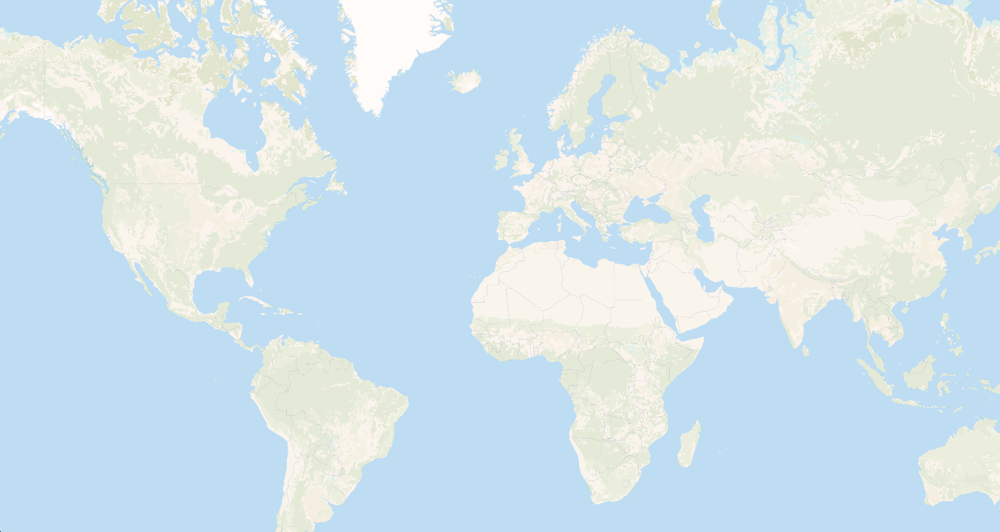

# Versatiles Landcover Vectors

A set of vector tiles based on [ESA Worldcover](https://esa-worldcover.org/en/data-access).

They complement OSM-based [Shortbread](https://shortbread-tiles.org/) tiles at low and mid zoom levels — see
[Shortbread compatibility](#shortbread-compatibility) below.

## Example



## Requirements

- `node` (or `bun`)
- [`GDAL`](https://gdal.org/) ≥ 3.13 with `gdalbuildvrt`, `gdaladdo`, `gdalwarp`, `gdalinfo`, `gdal_translate`, `gdal_calc.py`, `ogr2ogr` and the `gdal raster` / `gdal vector` subcommands `calc`, `edit`, `sieve`, `polygonize` and `simplify-coverage` on `PATH`
- Python 3 with `numpy` (used by `gdal_calc.py` for the per-class masks; both ship with the GDAL install)
- [`libvips`](https://www.libvips.org/) (`vips`) — used for the Gaussian blur
- [`tippecanoe`](https://github.com/felt/tippecanoe) (e.g. `brew install tippecanoe`) — `tippecanoe-decode`, which ships with it, is used by `npm run stats -- --attribute`
- [`versatiles`](https://github.com/versatiles-org/versatiles-rs/blob/main/versatiles/README.md#install)
- for `npm run preview`: a browser, and internet access for MapLibre GL from a CDN (the tiles themselves are served locally)

## How it's made

The pipeline turns the global landcover raster into smooth per-class polygons and tiles them into Shortbread's
`land` and `water_polygons` layers. There are just two scripts — a one-time source download and the build:

```sh
npm run download   # once: build the EPSG:3857 source raster from the remote tiles
npm run build      # everything else → data/landcover.versatiles
```

`build` runs: **coverage index → for each zoom 0–10 ( per-block processing → per-zoom tiling ) → merge & pack**.
Everything reads and writes under `data/`; the final container is `data/landcover.versatiles`.
All the parameters below live in `config.ts`.

> **Resources.** A full z0–10 build needs roughly **150 GB** of disk under `data/` (the ~23 GB EPSG:3857 source
> plus the per-block / per-zoom caches) and on the order of **300 core-hours** of CPU. It's heavily
> parallelised, written to be resumable, and the caches let you stop and continue, but plan for a long run on a
> many-core machine with ample free disk.

### Why blocks

A naïve pipeline renders one global EPSG:3857 raster per zoom level. At the resolution we want that reaches
60000×60000 px and beyond, and a global coverage-simplify loads the whole thing into RAM and gets OOM-killed.
Instead each zoom is processed in **blocks** of `BLOCK`×`BLOCK` = 8×8 tiles (`TILE_PX` = 1024 raw px per tile),
so every raster/vector operation works on a ≤ ~8242² px window — bounded memory, feasible at every zoom. The
blocks are stitched back into a seamless layer by a single per-zoom tippecanoe run.

### Build the source raster

```sh
node bin/download.ts
# or
npm run download
```

Reads the [ESA WorldCover 2021 (v200)](https://registry.opendata.aws/esa-worldcover-vito/) tiles **directly from
AWS Open Data** (`s3://esa-worldcover`) over `/vsicurl` — no local per-tile mirror. The ~2651 remote GeoTIFFs are
mosaicked into one virtual raster (`gdalbuildvrt`), and a single `gdalwarp` reprojects them into **one EPSG:3857
GeoTIFF** covering the whole Mercator square at the deepest zoom's resolution (`FULL_PX` = `TILE_PX`·2^`MAXLEVEL`
= 1 048 576 px per side, ≈ 38 m/px), written to `data/0_download/worldcover-3857.tif`; `gdaladdo` then adds an
overview pyramid down to z0.

Because every ESA tile carries internal overviews, the VRT exposes virtual overviews, so the warp reads a coarse
level instead of the full 10 m data — the transfer is a fraction of the ~124 GB full dataset. Resampling is
`-r mode` (dominant class — the only correct choice for categorical data). The GeoTIFF is tiled (512×512 blocks),
ZSTD-compressed (level 9, about a third smaller than fast DEFLATE at the same speed), BigTIFF, and **sparse** — all-no-data ocean blocks aren't stored. The
remote tile list is saved alongside (`_source-tiles.txt`) for the build's skip-empty step, and the raster is
written atomically, so an interrupted run leaves no half-built source.

> The old download step kept a reduced-resolution local mirror of all 2651 tiles; this builds the reprojected
> source in one pass instead.

### Per-block processing

`lib/block.ts` turns one block at one zoom into `land`/`water_polygons` polygon fragments. Each block reads its
window from the single EPSG:3857 source raster (built by the download step) and runs the same chain on it. The
read (`gdalwarp -te <block ± margin> -ts <px> -r mode -multi`) hits the source's overview pyramid, so a low-zoom
block reads a coarse pyramid level rather than the full-resolution data (≈100× less to read), while high-zoom
blocks read full detail; uncovered pixels are no-data:

1. **Channels** — for each landcover class _active at this zoom_ build a 0/255 membership mask; ESA 0 plus
   every class **not** active at this zoom folds into the no-data channel. All masks come from **one**
   `gdal_calc.py` call (repeated `--calc` → one band per channel), so the window is read once and Python
   starts once however many channels are active.
2. **Blur** — one `vips gaussblur` over that multi-band raster (σ = `BLUR_RADIUS` = 3 px, i.e.
   `BLUR_RENDERED` = 0.75 rendered px); vips blurs each band independently. The blur is what makes the next
   step yield **curved** boundaries instead of a pixel staircase, while shared borders stay exact.
3. **Argmax** — the channel with the highest blurred value wins each pixel
   (`gdal raster calc --calc argmax --flatten` reduces the bands to the winning index), giving a clean
   single-band coverage; `gdal raster edit` re-attaches the EPSG:3857 georeferencing that vips strips.
   Steps 1–3 are three processes per block regardless of channel count.
4. **Sieve** — `gdal raster sieve` drops specks smaller than a circle of the blur radius (`SIEVE_THRESHOLD` =
   round(π·r²) = 28 px).
5. **Crop** — `gdal_translate -projwin` cuts the classified raster to the block's exact inner 8×8-tile rectangle
   in EPSG:3857, discarding the margin. (Cropping the _raster_ rather than clipping the _vectors_ keeps the edge
   pixel-exact and avoids the boundary slivers a vector clip can turn into GeometryCollections.)
6. **Polygonize** — `gdal raster polygonize` → one polygon per region (field `code` = channel index), a
   **gap-free coverage of the whole block, including the no-data class**.
7. **Simplify** — coverage-simplify (`gdal vector simplify-coverage --preserve-boundary`, tolerance
   `(2·MERC)/(256·DETAIL_PX·2^z)` ≈ 1 px at a 256·`DETAIL_PX` px tile, `DETAIL_PX` = 1 today) —
   topology-preserving, so shared borders stay aligned.
   ⚠️ **simplify-coverage only simplifies the _interior_ edges shared between adjacent polygons**;
   `--preserve-boundary` freezes the _exterior_. So the input must be a **100 %-filled coverage with no holes** —
   the no-data polygons included. If no-data were dropped first, every coastline would be exterior boundary and
   keep its raw pixel staircase. (That is why polygonize keeps no-data and the drop happens in step 8, not here.)
8. **Tag & split** — drop the no-data class, tag each polygon's Shortbread `kind` (SQLite `CASE` on `code`),
   reproject to EPSG:4326, and split into the block's `land` and `water_polygons` fragments
   (`-nlt PROMOTE_TO_MULTI`).

The **margin** (`MARGIN_PX` = ceil(3·`BLUR_RADIUS` + 3·√`SIEVE_THRESHOLD`) = 25 px) around each block means the
blur and sieve at the inner edge see the same neighbourhood they would in a global pass, so a class never
changes across a block seam. The blocks are cropped at **pixel-aligned, tile-exact** EPSG:3857 coordinates and
simplified with `--preserve-boundary`, so adjacent blocks share an identical straight edge — no gaps or slivers.

Which classes are active is per zoom: each `kind` is emitted up to its cutoff (the `maxZoom` column in
`config.ts` — z10 for every kind today, see the mapping table below). Above its cutoff a class folds into
no-data, so the block produces nothing there and OSM takes over.

**Low-diversity fast paths.** Right after the warp, one histogram read of the window (`gdalinfo -hist`) tells
which ESA values are actually present. Most blocks at high zoom sit inside a large uniform region (Sahara,
boreal forest, a mostly-ocean coastal cell), so:

- **Channel pruning** — masks + blur are built only for the kinds present; an absent kind's mask is all-zero,
  blurs to all-zero and can never win the argmax, so skipping it is exact (byte-identical output), not an
  approximation.
- **Uniform short-circuit** — if the whole window is a single value, or maps to no active kind at all, the
  entire blur → argmax → sieve → polygonize → simplify chain is skipped and the block is emitted directly as the
  inner rectangle (`win.innerLonLat`) tagged with that `kind`, or as empty fragments. The histogram must cover
  the whole window incl. the margin, so a value that only appears in the margin (and bleeds into the inner edge
  via the blur) is never wrongly pruned.
  ⚠️ **GDAL leaves no-data pixels out of the histogram**, so "a single value" is _not_ the same as "one value
  everywhere": a mostly-ocean coastal block with a single land class reports exactly one value. The test
  therefore also requires the histogram's pixel count to equal the window's pixel count (`nodata_px` = 0 in the
  log) — otherwise the block would get its whole inner rectangle painted with that kind, ocean included.

Both the per-block fragments (`data/1_results`) and the per-zoom tilesets (`data/2_tiles`) are **cached**: each
is written atomically (temp file renamed on success), and on re-run a block whose fragments already exist is
skipped — and a zoom whose `z{z}.mbtiles` already exists is skipped wholesale, without even iterating its blocks.
So an interrupted build resumes where it left off. The cache is keyed only on zoom + block position, so after
changing parameters in `config.ts` clear it (or run `npm run clean`) to force a rebuild.

### Skip-empty

ESA only ships 3° tiles where land exists (open ocean has no tile). `lib/coverage.ts` builds the set of occupied
3° cells from the recorded source tile list (`_source-tiles.txt`); a block whose bounding box intersects no occupied cell has no source data
and is skipped entirely (it would only have produced dropped no-data). At high zoom most blocks are ocean, so
this removes the bulk of the work. The test is conservative — it never skips a block that overlaps land — so it
can't create wrong holes.

### Per-zoom tiling

`lib/assemble.ts` unions all of a zoom's block fragments per layer (OGR VRT union → one FlatGeobuf), then runs
**one** `tippecanoe -Z z -z z -L land:… -L water_polygons:…` → `data/2_tiles/z{z}.mbtiles`. Doing the whole zoom
in one pass lets tippecanoe's per-tile buffers fill across block seams (no hairlines), and
`--coalesce-smallest-as-needed` keeps the coverage complete — when a low-zoom tile (e.g. the whole world at z0)
would exceed the MVT size limit, the smallest polygons merge into their neighbours rather than being dropped.
Only `kind` is kept in the tiles.

### Merge & pack

`tile-join` merges the per-zoom tilesets (disjoint zoom ranges) into `data/landcover.mbtiles`, then
`versatiles convert -c brotli` packs it into `data/landcover.versatiles`, stamping
`tile_schema: shortbread@1.0` on the way (`meta_update`) — tippecanoe has no way to declare that, and
without it the container ships as `"other"` and a consumer cannot tell that a stock Shortbread style fits.
The build finishes by printing a per-zoom tally of how its blocks were processed (branch counts, core-hours
and the parallel speed-up) from `data/blocks.log`.

To preview the result, `npm run style` writes a QGIS vector-tiles style (`landcover.qml`) that colours both
layers by `kind`.

### Size statistics

```sh
npm run stats                                              # per-zoom distribution of data/landcover.mbtiles
npm run stats -- --area hudson-bay --worst 5 --attribute   # the biggest tiles, and what fills them
npm run stats -- --baseline write                          # remember the numbers in doc/size-baseline.json
npm run stats -- --baseline compare                        # diff a later build against them
```

`bin/stats.ts` reads tile sizes straight out of the mbtiles (`node:sqlite`, no external tool): those are the
compressed bytes a client downloads, which is what tippecanoe's `--maximum-tile-bytes` (500 000) applies to. For a
parameter change the **maximum** is what matters, not the average — past the limit tippecanoe coalesces or drops
features and the coverage quietly loses detail, so the command exits non-zero when any tile reaches it.

The maximum is always local: one fragmented landscape decides it. `--area` therefore restricts the measurement to
an area of interest (`--areas` lists the presets, or pass `west,south,east,north`). The presets are the shapes
that stress the pipeline differently — `hudson-bay` is where the largest tiles of the z0–10 build actually sit,
plus archipelago, fjord, delta, desert and glacier cases. `--worst N --attribute` decodes those tiles with
`tippecanoe-decode` and reports features and vertices per layer and `kind`, which answers _why_ a tile is big.

`doc/size-baseline.json` holds the numbers of a build so a later one can be diffed against it; `--label` keeps
variants of a parameter sweep apart. For the z0–10 build the worst tile is **60.5 KB at z9** (Hudson Bay
Lowlands, 2273 features / 36 k vertices), with an average of 6–10 KB per tile — roughly **8× headroom** to the
500 000-byte limit, which is the budget available for more detail.

### Preview / developer mode

```sh
npm run preview -- --area hudson-bay --zoom 4-10   # build that area, serve it, open the viewer
npm run preview -- --bbox 4,58,12,64 --watch       # rebuild and reload when config.ts changes
npm run preview -- --tiles data/landcover.mbtiles  # just look at an existing tileset
```

A parameter change is worth a few minutes on one area, not eleven hours on the planet. `bin/preview.ts`
plans the blocks of one area of interest (`--areas` in `npm run stats` lists the presets), runs them
through **the same** `lib/pipeline.ts` the build uses — a preview on a different code path would prove
nothing — joins them into one mbtiles and serves it with `versatiles serve`.

Each parameter set builds into `data/preview/<config fingerprint>/`, so flipping between two settings
reuses each one's cache instead of rebuilding. `--watch` reruns the build in a child process (ESM cannot
reload `config.ts`), remounts the server on the new fingerprint and the viewer reloads itself.

The viewer (`dev/viewer/`, MapLibre GL) is built around the things that are hard to judge from the
terminal:

- the **real OSM Shortbread container** is mounted alongside, straight from `download.versatiles.org` over
  range requests — so the handover at each kind's cutoff is visible against real OSM data without
  downloading 66 GB. OSM's `ocean` is drawn _under_ the landcover, so the no-data holes show up as ocean.
- the **block grid** overlay is generated from `blockWindow()` itself, so a seam can be attributed to a
  block boundary instead of guessed at.
- a legend generated from `channels` (colour, kind, and the `≤ z` cutoff), with per-kind and per-source
  toggles, MapLibre's tile boundaries, click-to-inspect, and the config fingerprint plus the live
  parameter values in the header — so a screenshot documents itself.
- the position lives in the URL hash (`#z/lat/lon`), which is what `npm run stats -- --worst` prints.

`npm run stats -- --probe hudson-bay --zoom 8-10` combines the two: preview-build the area at the current
config, then measure the tiles it produced.

### Quality and size: the knobs

Two stages decide how a tile looks, and they are tuned separately. All four knobs live in `config.ts`; the
first three can be overridden per run for a sweep, and each builds into its own cache because all of them are
part of the config fingerprint.

| stage  | knob                                                         | what it changes                                                                                      | override                   |
| ------ | ------------------------------------------------------------ | ---------------------------------------------------------------------------------------------------- | -------------------------- |
| raster | `BLUR_RENDERED` (0.75 rendered px)                           | the Gaussian σ before the per-pixel majority vote — **which class ends up where**                    | `LANDCOVER_BLUR_RENDERED`  |
| raster | `SIEVE_RENDERED` (π·σ², so it follows the blur)              | the smallest patch kept; the main lever on feature count; 0 turns it off                             | `LANDCOVER_SIEVE_RENDERED` |
| vector | `DETAIL_PX` (1)                                              | the simplify tolerance — how precisely outlines follow the result                                    | `LANDCOVER_DETAIL_PX`      |
| raster | `TILE_PX` (1024 → 38 m/px at z10, against ESA's native 10 m) | the resolution the source is classified at; 4× source raster and CPU per doubling, and a re-download | — (edit, then re-download) |

**The raster stage decides the quality; the vector stage only refines outlines.** Measured on the worst
tile of the z0–10 build (9/129/159, Hudson Bay Lowlands), against what it should show:

| variant           | agreement at 256 px | heath kept | tile KB |
| ----------------- | ------------------- | ---------- | ------- |
| blur 0.5          | 79.4 %              | 36 %       | 98.5    |
| blur 0.75 (today) | 74.5 %              | 27 %       | 60.4    |
| blur 1.0          | 69.3 %              | 20 %       | 39.3    |
| `DETAIL_PX` 4     | 77.9 %              | 31 %       | 93.9    |

At about the same size, a smaller blur beats a finer tolerance on every measure: the blur is where scattered
classes are voted away (heath loses half its area in that one step), and no outline precision brings them
back. `DETAIL_PX` 4 costs 1.56× the bytes of `DETAIL_PX` 1, far less than 4×, because MVT delta-encodes
dense vertices; beyond `DETAIL_PX` ≈ 16 the MVT grid quantises the extra precision away (tippecanoe's default
`--detail 12` is 4096 units per tile, i.e. 16 per rendered pixel). The budget is tippecanoe's
**500 000 bytes** per tile.

```sh
npm run sweep -- --area hudson-bay --zoom 9 --blur 0.5,0.75,1        # the raster stage: size and quality
LANDCOVER_SIEVE_RENDERED=1.77 npm run sweep -- --area hudson-bay --zoom 9 --blur 0.5,0.75,1   # sieve held fixed
npm run sweep -- --area hudson-bay --zoom 8-10 --detail 1,2,4        # the vector stage
npm run inspect -- 9/129/159 --preview hudson-bay                    # one tile, every variant built for the area
```

A sweep builds the area once per value, prints the worst tile per zoom per variant, records each in
`doc/size-baseline.json` as `<area>@<knob><value>`, and ends with `npm run inspect` on a reference tile
(`--tile`, or the largest tile of the first variant). `inspect` rasterises the tile onto the pipeline's own
grid and compares it pixel by pixel with its **target**: the source read at `TILE_PX` like a block reads it,
with every class the zoom does not draw turned into a hole. It reports each class's area and how much of it
was kept, the overall agreement — at full resolution, which also counts the pixel-level mosaic the blur
removes on purpose, and at the 4×4 majority the tolerance is calibrated to, which is the structural number —
the errors split into wrong kind, gap and overdraw, and the tile's bytes, features and vertices. It also
writes a PNG to `data/inspect/` with the source, the target, and each variant next to a map of its errors.

Raising `TILE_PX` is the bigger operation: blur, sieve and tolerance are all set in rendered pixels (via
`OVERSAMPLE`), so it refines the grid they operate on without changing them. `FULL_PX` changes, so the source
raster has to be rebuilt (`npm run download` — the stamp in `data/0_download` makes a stale one an error rather
than a surprise), and the per-block window is `BLOCK`×`TILE_PX` pixels, so **halve `BLOCK` when doubling
`TILE_PX`** to keep memory per block where it is.

The target above cannot judge that change: it _is_ the source at `TILE_PX`, so whatever the download's `-r mode`
throws away is missing from the target too, and a new `TILE_PX` moves the target along with the tile.
`--native` measures against ESA's own 10 m pixels instead, read straight from the remote COGs (no source raster
needed), and replays the source's resampling for this one tile at each `--tile-px`:

```sh
npm run inspect -- 9/129/159 --native --tile-px 1024,2048            # ~10 s; tilesets present are added last
```

Each stage is scored by its area share per class against the native share (grid-independent) and by the
agreement of the 256-px majorities. The stages are: `10 m mode` (the download's warp forced onto ESA's base
level), `download` (the warp as it runs, on whichever ESA overview GDAL picks — the difference is what ESA's
overviews cost), `pyramid` (our mode overview read like a block, below z10 — the cascaded majority vote), and
then each tileset, which adds blur, sieve and simplify. On 9/129/159 the source loses little at 1024 (heath
95 % kept, 92 % agreement through the z9 pyramid) and a bit less at 2048 (98 %, 96 %); the blur's loss sits on
top of that.

## Shortbread compatibility

This project does **not** define its own layer. It produces a `.versatiles` container that adds polygons to
Shortbread's **own** [`land`](https://shortbread-tiles.org/) and **`water_polygons`** layers, at the **zoom
levels where OpenStreetMap is still sparse or absent (z0–10)**. You then **feature-merge** it with an OSM-based
Shortbread container (the VersaTiles CLI merges tilesets at the feature level) to get one seamless tileset.

Shortbread's `land`/`water_polygons` are OSM-derived: sparse (only what's mapped) and high-zoom (`land`
introduces its kinds from z7 upward, `water_polygons` from z4). Below those zooms a world map has no landcover
at all. This container fills exactly that gap with a **complete, generalized classification from global
satellite imagery** ([ESA WorldCover](https://esa-worldcover.org/), CC BY) — wall-to-wall, from z0 — written
into Shortbread's _own_ layer names and `kind` values, so **no schema extension and no new style rules are
needed**: a stock Shortbread style simply starts drawing `land`/`water_polygons` at low zoom.

**One handover, at z10 → z11.** Every kind is emitted up to z10 (`fills` column below). OSM has its own copies of
some of them earlier — `forest` from z7, `farmland` and `residential` from z10, `glacier` and `water` from z4
— but they are sparse where the satellite data is complete (in central Spitsbergen, OSM maps 9 % of a tile as
glacier where ESA sees 96 % ice). So a merge **drops OSM's features of these kinds up to z10** (see
[Using it](#using-it)); from z11 OSM takes over every kind. Each zoom then has exactly one source per kind, and
the handover sits at the same zoom for all of them. OSM's other kinds (`river`, `reservoir`, `park`, …) are
kept at every zoom. ESA's open ocean / no-data is left out, so those areas stay holes for Shortbread's `ocean`
layer to fill.

### ESA WorldCover → Shortbread mapping

| ESA WorldCover class     | → layer          | `kind`        | this container fills |
| ------------------------ | ---------------- | ------------- | -------------------- |
| Tree cover               | `land`           | `forest`      | z0–10                |
| Cropland                 | `land`           | `farmland`    | z0–10                |
| Built-up                 | `land`           | `residential` | z0–10                |
| Bare / sparse vegetation | `land`           | `bare_rock`   | z0–10                |
| Moss & lichen            | `land`           | `heath`       | z0–10                |
| Shrubland                | `land`           | `scrub`       | z0–10                |
| Grassland                | `land`           | `grassland`   | z0–10                |
| Herbaceous wetland       | `land`           | `marsh`       | z0–10                |
| Mangroves                | `land`           | `swamp`       | z0–10                |
| Snow and ice             | `water_polygons` | `glacier`     | z0–10                |
| Permanent water bodies   | `water_polygons` | `water`       | z0–10                |
| No data / open ocean     | —                | _(dropped)_   | —                    |

Every `kind` here is an existing Shortbread value, so the output validates and styles as plain Shortbread. The
cutoff is z10 for every kind: most of OSM's `land` kinds start at z11 anyway (Shortbread 1.1), and where OSM
starts earlier, its copies are dropped at the merge.

Some mappings are deliberately **lossy generalizations** — ESA can't resolve the OSM detail, and at these
zooms it doesn't matter visually:

- **Built-up → `residential`** — ESA's single "built-up" class can't distinguish residential / industrial /
  commercial; `residential` is the generic settlement fill.
- **Bare / sparse vegetation → `bare_rock`** — this class conflates rocky/gravelly barrens (Iceland, tundra,
  high mountains) with sandy deserts, which ESA can't tell apart; `bare_rock` renders neutrally for both,
  where `sand` would tint every barren yellow. Sandy deserts lose their sand tint as a result.
- **Moss & lichen → `heath`** — Shortbread has no moss/lichen value; `heath` is the closest low tundra
  vegetation fill.

`wetland` is split to keep fidelity: herbaceous wetland → `marsh`, mangroves → `swamp`.

> **The complete→sparse handover.** Up to z10 this data is a complete wall-to-wall coverage; from z11, OSM is
> sparse. Expect the landcover to thin out at z11 — that is inherent to swapping a satellite classification for
> hand-mapped OSM, and a base land/ocean fill underneath covers the gaps.

### Using it

Merge this container with your OSM-based Shortbread tiles using the VersaTiles CLI (feature-level merge), and
drop OSM's own features of the landcover kinds up to z10 on the way in — otherwise both sources draw them at
the same zooms. The combined tileset then has `land`/`water_polygons` populated continuously from z0, from
one source per kind and zoom. No style changes are required — a standard Shortbread style already has rules
for `forest`, `farmland`, `water`, `glacier`, etc.

```sh
npm run merge      # data/landcover.versatiles + OSM → data/combined.versatiles
```

`merge` downloads the latest OSM Shortbread container from
[download.versatiles.org](https://download.versatiles.org/osm.versatiles) to `data/osm.versatiles` (~66 GB,
once and resumable — skipped if already present), then feature-merges it with `data/landcover.versatiles` via
the VersaTiles `from_merged_vector` pipeline into `data/combined.versatiles`, with OSM filtered as below. The
filter is generated from `channels` (`lib/handover.ts`), so it follows any change of a cutoff.

To merge by hand, write the pipeline to a file — the filter's CEL strings use single quotes, which a shell
argument in single quotes cannot hold — and convert it:

```sh
cat > merge.vpl <<'EOF'
from_merged_vector [
  from_container filename="osm.versatiles"
    | vector_filter_features layer=["land"] expr="!(zoom <= 10 && kind in ['forest', 'farmland', 'residential', 'bare_rock', 'heath', 'scrub', 'grassland', 'marsh', 'swamp'])"
    | vector_filter_features layer=["water_polygons"] expr="!(zoom <= 10 && kind in ['glacier', 'water'])",
  from_container filename="landcover-vectors.versatiles"
]
EOF
versatiles convert -c brotli merge.vpl combined.versatiles
```

> **Needs versatiles ≥ 4.15.0.** `vector_filter_features` gained the tile's `zoom` in 4.15.0. Older versions do
> not report an error: 4.14.0 silently drops every feature of the filtered layers, at every zoom, so the merged
> tileset ends up without `land`. `npm run merge` checks the version and refuses to run below 4.15.0.

## License

- [ESA Worldcover](https://esa-worldcover.org/en/data-access) is licensed [CC BY 4.0](http://creativecommons.org/licenses/by/4.0/)
- The Versatiles Landcover Vectors tileset is derived from ESA Worldcover and therefore also licensed [CC BY 4.0](http://creativecommons.org/licenses/by/4.0/)
- The code in this repository is in the [Public Domain](http://unlicense.org/UNLICENSE)
